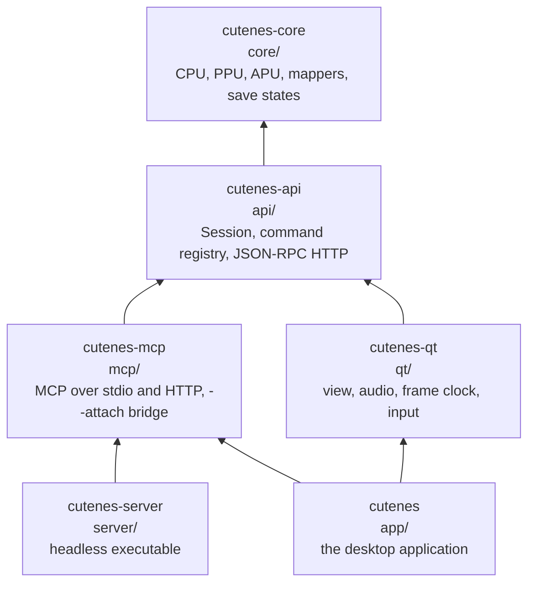

# Architecture

How cuteNES is put together: the layers, what each owns, which threads run
what, and how frames, sound, input and commands move between them. The
reasons behind the shape are in [`design-philosophy.md`](design-philosophy.md);
the full designs are in each feature's `plan.md` and `research.md` under
[`specs/`](../specs/).

## The layers

Each layer links only the ones below it, through their public headers, and
the CMake link dependencies enforce the direction. `cutenes-server` has no
Qt in it.

| Layer | Directory | Owns | Depends on |
|---|---|---|---|
| `cutenes-core` | `core/` | The emulated machine: 6502 CPU, 2C02 PPU, APU, the cartridge and its mapper, the bus, the master clock, save states, cheats. Public API: `core/include/cutenes/cutenes.hpp` | nothing at run time |
| `cutenes-api` | `api/` | The `Session` (the one `Machine` and its command queue), the command registry with JSON Schemas, the `core.*`, `session.*` and `api.*` commands, the `IHost` extension point, the JSON-RPC HTTP server and its tokens | core, nlohmann/json, cpp-httplib |
| `cutenes-mcp` | `mcp/` | MCP (revisions 2026-07-28 and 2025-11-25) over stdio and Streamable HTTP, listing the registry as tools; the `--attach` bridge | api |
| `cutenes-server` | `server/` | The headless executable: flags, one session, the transports it was asked for | api, mcp |
| `cutenes-qt` | `qt/` | Reusable Qt pieces with no application logic: `EmulationView`, `AudioOutput`, `FrameClock`, `InputMapper`, gamepads (SDL3) | api, Qt 6, SDL3 |
| `cutenes` | `app/` | The product: main window and menus, the library, persistence (battery saves, states, rewind, settings), dialogs, debug tools, cheats, movies, the self-update, and `GuiHost`, which registers the `gui.*` commands | qt, mcp |

**General idea:** the model of the machine sits at the bottom with no
dependencies; a command layer above it is the single way in; transports
and UIs are thin layers over the command layer. Any emulator, or any
program with a simulation inside, can take this shape.

## One session, one emulation thread

The `Session` (`api/include/cutenes/api/session.hpp`) owns the `Machine`.
**Only its emulation thread ever touches the machine.** Everyone else,
whether an HTTP request, an MCP tool call or a menu click, submits a
command to the session's queue, and the emulation thread runs each command
to completion in arrival order.

This gives cuteNES its ordering guarantee without locks in the core: two
clients can never interleave inside one command, and no command runs while
a real-time frame is being emulated. A command that calls another
command from the emulation thread runs it inline.

### Real-time play

A headless session runs frames only when asked (`core.run_frames`). The
desktop application turns on real-time play:

1. `FrameClock` requests frames from a timer thread at the console's rate
   (60.0988 per second for NTSC, 50.0070 for PAL), or at the display's
   refresh rate when that is within 1% (sync to display).
2. Between queued commands, the emulation thread runs one frame per
   request. At most twice the latest request is ever pending, so a stall
   never turns into a burst.
3. At each frame's start, the session applies the buttons a human holds,
   combined (OR) with the last `core.set_controller` value, so a person and
   an agent can play together.
4. A host can replace the plain frame with its own runner; rewind uses this
   to capture a state before each frame and to play stored states back.

## Threads

| Thread | Runs | Touches the machine |
|---|---|---|
| Emulation | queued commands, real-time frames, every command handler (including `gui.*`), event callbacks | yes, the only one |
| GUI (Qt main) | widgets, painting, menus, dialogs, gamepad polling | no; it submits commands |
| Frame clock | requests frames on the console's or display's beat | no |
| Audio (SDL) | pulls queued samples for the sound card | no |
| HTTP listeners | parse requests, submit commands, wait for results | no |
| Battery saver | writes `.sav` files, at most once per interval | no; it gets copies of the RAM |

**Command handlers that touch widgets** (`app/host/gui_host.cpp`) post the
widget work to the GUI thread with `QMetaObject::invokeMethod`, queued.
They block on the GUI thread (`BlockingQueuedConnection`) only when the
result depends on it. A command that opens a dialog returns as soon as it
is shown, and the dialog's own commands drive it, so no handler ever waits
on a person.

## How data moves

**Frames.** The machine hands each 256x240 frame to its video sink on the
emulation thread. `EmulationView` puts it in a `FrameMailbox`, which keeps
only the newest frame and never makes the writer wait. The GUI thread draws
whatever is newest, through `QRhiWidget` (Metal, Direct3D, Vulkan or
OpenGL), or with `QPainter` when no GPU path works.

**Sound.** The APU's samples go to `AudioOutput`, which queues them in an
SDL3 audio stream. The emulator's clock and the sound card's never agree
exactly, so dynamic rate control (`AudioPacer`) nudges the playback rate by
at most ±0.5% to keep the queue near its target latency. This approach is
general to any emulator whose sound is made at the emulated machine's rate
but played by a device with its own clock.

**Input.** Keys and gamepad buttons go through `InputMapper`, which applies
the Key Bindings page, combines everything held for a player, and resolves
opposite directions. The window passes the result to the session as live
input, which it applies at the next frame's start.

**Commands.** Every menu item is a `QAction` carrying its `gui.*` command
name. Triggering it calls the command through the session, the same path
an MCP tool call or a JSON-RPC request takes. `gui.*` commands are
registered by `GuiHost` through `IHost`, and they appear in `api.catalog`
and MCP's `tools/list` automatically.

**Events.** The session publishes state changes, run-state changes, frames
(at most 10 per second) and catalog changes. The API serves them as
Server-Sent Events; MCP turns catalog changes into list-changed
notifications.

## The two run modes

| | Headless (`cutenes-server`) | Desktop (`cutenes`) |
|---|---|---|
| Frames run | only on `core.run_frames` and stepping commands | in real time while a game is running |
| Catalog | `core.*`, `session.*`, `api.*` (54 commands) | the same plus every `gui.*` command |
| Transports | MCP over stdio by default; HTTP on flags | API and MCP behind Settings > Servers, off by default |
| Stdio clients | connect directly | connect through `cutenes-server --attach` |

Both build the same `Session`, so a test of one is largely a test of the
other.

## Where to go next

- [Using the core](using-the-core.md) and its API contract.
- [Automation: MCP and the API](automation.md).
- [Building and testing](building-and-testing.md).
- The designs: [002 plan](../specs/002-ai-mcp-server/plan.md),
  [003 plan](../specs/003-qt-frontend/plan.md) and their `research.md`.
