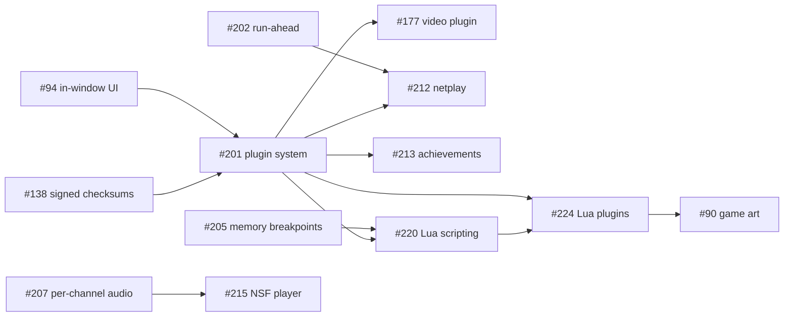

# Roadmap

What is planned after the current release, in the order it can be built.
The GitHub milestones ([1.0](https://github.com/tdjustus/cuteNES/milestone/1),
[2.0](https://github.com/tdjustus/cuteNES/milestone/3),
[3.0](https://github.com/tdjustus/cuteNES/milestone/4),
[Later](https://github.com/tdjustus/cuteNES/milestone/2)) are the source of
truth for what is in each release and whether it is done. This page
explains how the pieces fit together. Each feature gets its own
specification before work on it starts
([`development-process.md`](development-process.md), step 2), so the
issues describe intent and open questions, not designs.

## Principles

Two decisions shape everything after 1.0 (both are in
[`decisions.md`](decisions.md)):

- **Optional features are opt-in plugins.** A plugin is something the user
  turns on, so a player who never wants a feature never installs its code.
  The project's own plugins are downloaded and updated automatically.
  Plugins from anyone else, in C++ or Lua, are installed by hand in the
  plugin manager. A plugin's commands join the command registry, so MCP
  clients, Lua scripts and other plugins call them alike.
- **Community standards over formats of its own.** Where the NES community
  already has a format, cuteNES adopts it: IPS, BPS and UPS patches, Lua
  scripting, and Mesen's HD packs.

## 1.0: finishing

Every 1.0 feature is merged, the last being the pause menu (#235). What
remains is:

- the hands-on test pass before the first beta (#190);
- deciding how the updater's install test can run, since the updater
  doesn't offer beta or release-candidate tags (#232);
- the README screenshot (#116);
- a test that failed once and is being watched (#193);
- the release itself (#33).

The betas are `v0.9.0-beta.N`. 1.0 ships when the milestone is empty.

## 2.0: plugins, and more of the NES

**Foundations first.** The rest of 2.0 builds on these.

| Issue | What | Why it comes first |
|---|---|---|
| #138 | Signed release checksums | The plugin manager verifies project plugins with them |
| #201 | The plugin system and plugin manager | Every plugin needs it: the video plugin in 2.0, and scripting, netplay and achievements in 3.0 |
| #94 | Every interaction inside the app window | Plugins add their panels and settings pages to it |

**The first plugin.** Video recording and export (#177) keeps a video
encoder out of the base download.

**Playing.**

| Issue | What |
|---|---|
| #202 | Run-ahead, to cut input lag. Its save-and-rerun loop is what netplay's rollback (#212) uses later |
| #203 | NTSC composite and CRT shaders |
| #204 | The Zapper and the Four Score |
| #207 | Volume and mute per audio channel |
| #206 | ROMs inside `.zip` and `.7z` archives |
| #219 | ROM hacks as IPS, BPS or UPS patches, applied on load |

**Tools.** Memory read and write breakpoints (#205). They add the core's
memory-access hooks, which Lua scripting (#220) needs in 3.0.

**Reach.** Translations (#208), ARM64 builds for Linux and Windows and a
Flatpak (#209), and portable mode (#210).

## 3.0: scripting, online play, more systems

**Scripting and enhancement.**

| Issue | What | Depends on |
|---|---|---|
| #220 | Lua scripting as a plugin, with a live console and editor, and the whole cuteNES API from Lua | #201, #205 |
| #224 | Plugins written in Lua, installed in the plugin manager, with an input display as the minimal sample for authors | #201, #220 |
| #90 | Opt-in game art for the library: the project's first Lua plugin, and the example for other authors | #224 |
| #221 | Mesen HD packs: replacement graphics and audio | |
| #211 | TAS tools: an input editor for movies | |

**Online, as plugins.** Netplay with rollback (#212, needs #201 and #202)
and RetroAchievements (#213, needs #201).

**More systems and formats.** The Famicom Disk System (#214), an NSF music
player (#215, with #207's per-channel audio), and the Dendy region (#216).

**Elsewhere.** cuteNES's core as a libretro core for RetroArch (#217), and
a startup splash screen, on by default and switchable off (#200).

## After 3.0

Accepted, but not yet given a release:

| Issue | What | Depends on |
|---|---|---|
| #229 | A speedrun auto-splitter as a Lua plugin: splits from game memory, sent to LiveSplit through its server | #220, #224 |

## How the pieces depend on each other

Everything not in the graph can be built in any order within its release.

## Adding to the roadmap

A suggestion becomes a roadmap item only when the maintainer agrees to it
([`source-control.md`](source-control.md), "Tracking work"). It is filed
as an issue in the milestone of the release it is planned for, with what
it does, what it must keep unchanged and its open questions. Then it is
added here, in the group it belongs to, with any dependencies.
